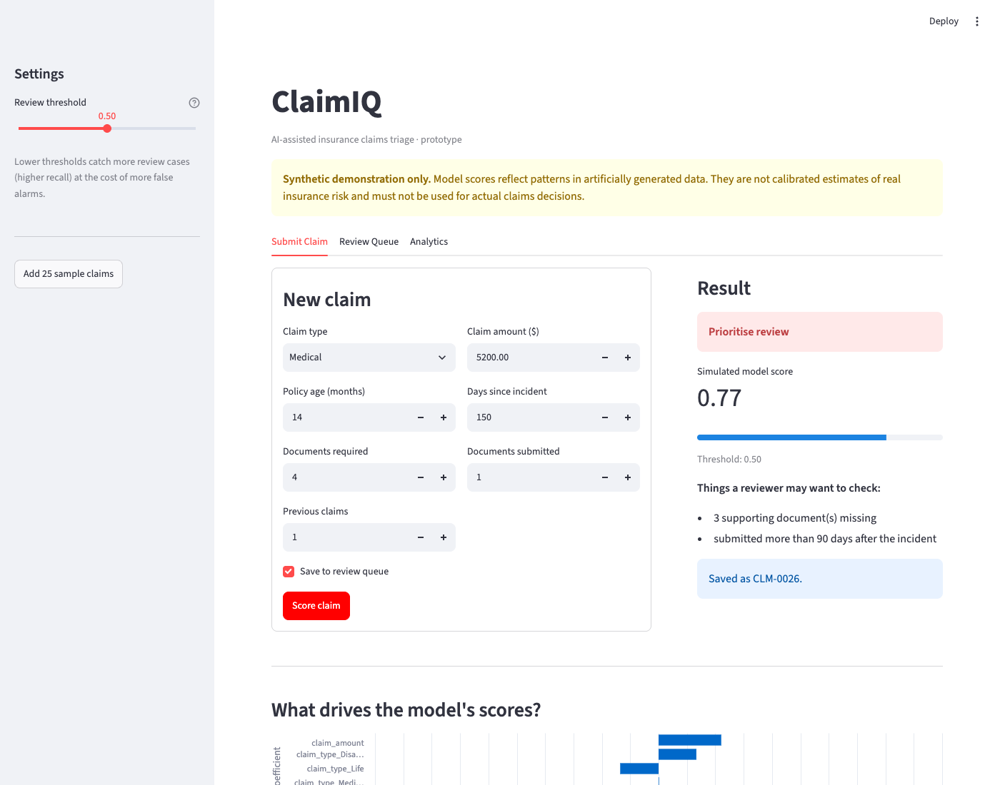
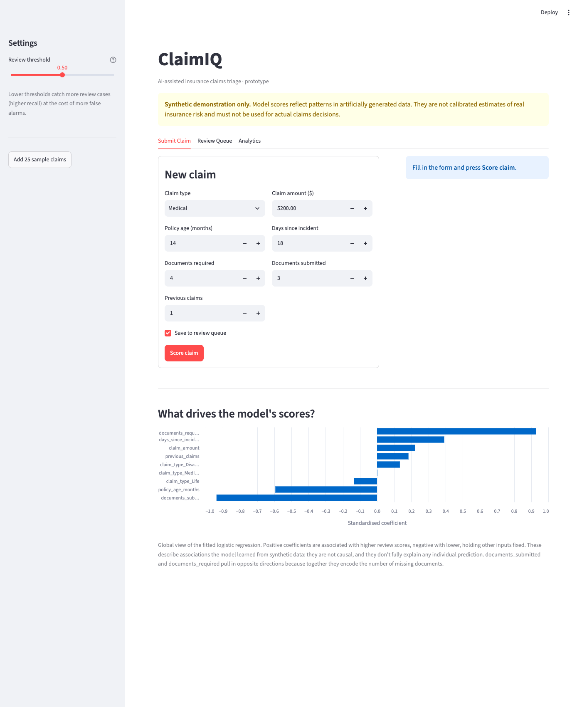
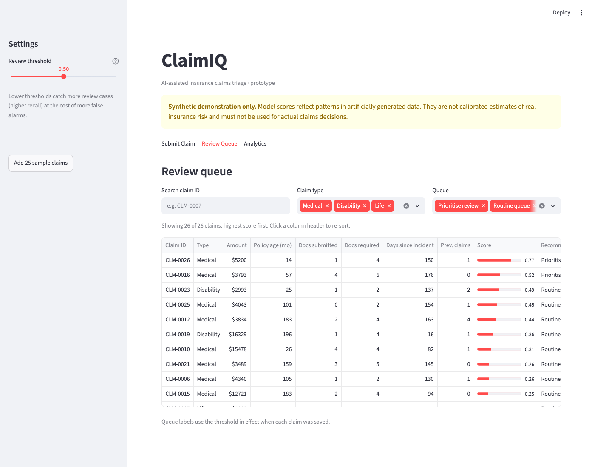
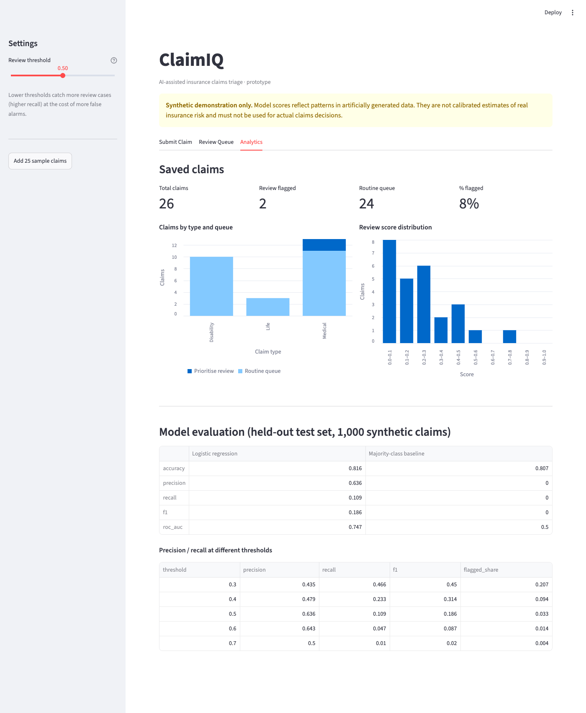

# ClaimIQ: Insurance Claims Triage Prototype

> **Synthetic demonstration only.** Every claim in this project is invented, and the review labels come from a documented simulation. The model has not been trained on real insurance data and must not be used for real claims decisions.

## 1. Project Overview

ClaimIQ is an end-to-end machine learning proof of concept that helps an insurance operations team decide which incoming claims to look at first. A user enters a claim through a web form. A logistic regression model scores how likely the claim is to need additional review, the app shows which factors the model weighs most heavily, and the scored claim is saved to a SQLite database. Reviewers can then search and filter the saved claims in a review queue and see summary analytics.

I built it to practise turning an operational problem into a working prototype: data generation, model training and evaluation, a validated prediction interface, SQL persistence, an interactive dashboard, tests and documentation.

## 2. Business Problem

Claims teams receive a steady flow of submissions, and reviewer time is limited. Some claims are routine. Others are incomplete, unusually large, or filed long after the incident, and benefit from early human attention. Working through claims in arrival order means those cases can wait behind routine ones.

A triage score doesn't make decisions. It **reorders the queue** so reviewers see the cases most likely to need attention first. Every claim still goes to a person; the model only affects the order and which queue a claim starts in.

## 3. Architecture

```
src/generate_data.py      ->  data/synthetic_claims.csv  (5,000 synthetic claims)
                                       |
src/train_model.py        ->  ColumnTransformer (StandardScaler + OneHotEncoder)
                              -> LogisticRegression
                              -> models/claim_model.joblib + models/metrics.json
                                       |
src/predict.py            ->  validate input -> predict_proba -> score + queue (configurable threshold)
                                       |
src/database.py           ->  SQLite (claims.db): init_db / save_claim / get_claims
                                       |
app.py (Streamlit)        ->  Submit Claim | Review Queue | Analytics
```

Preprocessing lives inside the scikit-learn `Pipeline`, so the scaler is fitted only on training data and the exact same transformation is applied at prediction time.

## 4. Technologies

- **Python 3**
- **pandas / NumPy**: data generation and transformation
- **scikit-learn**: preprocessing pipeline, logistic regression, evaluation, baseline
- **SQLite** (Python's built-in `sqlite3`): parameterised storage of scored claims
- **Streamlit**: interactive dashboard
- **pytest**: tests for data validity, predictions, input validation and database writes

## 5. Installation

```bash
git clone https://github.com/arnavgupta3911/claimiq-insurance-triage.git
cd claimiq-insurance-triage

python3 -m venv .venv
source .venv/bin/activate          # Windows: .venv\Scripts\activate
pip install -r requirements.txt

python -m src.generate_data        # creates data/synthetic_claims.csv
python -m src.train_model          # trains, evaluates, saves models/claim_model.joblib
python -m pytest                   # runs the test suite
streamlit run app.py               # opens the app at http://localhost:8501
```

The dataset and trained model are already committed, so you can skip straight to `streamlit run app.py`. Re-running the generator and trainer reproduces the same files, because both use fixed random seeds. To populate the dashboard quickly, click **Add 25 sample claims** in the sidebar.

## 6. Model Performance

Held-out, stratified test set of 1,000 claims (80/20 split, `random_state=42`). Test-set review rate: 19.3%.

| Metric | Logistic regression (threshold 0.5) | Majority-class baseline |
|---|---|---|
| Accuracy | 0.816 | 0.807 |
| Precision | 0.636 | 0.000 |
| Recall | 0.109 | 0.000 |
| F1 | 0.186 | 0.000 |
| ROC AUC | **0.747** | 0.500 |

Confusion matrix at 0.5: 795 true negatives, 12 false positives, 172 false negatives, 21 true positives.

**What this means:**
- The model ranks claims meaningfully better than chance (ROC AUC 0.75 vs 0.50). That's the most relevant number for a tool whose job is to reorder a queue.
- Accuracy barely beats the baseline. Because only about 19% of claims are review cases, a model that flags nothing already scores 80.7%. Accuracy is therefore a poor metric here.
- **At the 0.5 demonstration threshold, recall is only 11%.** The model rarely becomes confident enough to cross 0.5, so most review cases end up in the routine queue. For triage, missing review cases is usually costlier than a few extra reviews, so 0.5 is a poor operating point.

| Threshold | Precision | Recall | F1 | Share flagged |
|---|---|---|---|---|
| 0.3 | 0.435 | 0.466 | 0.450 | 20.7% |
| 0.4 | 0.479 | 0.233 | 0.314 | 9.4% |
| 0.5 | 0.636 | 0.109 | 0.186 | 3.3% |
| 0.6 | 0.643 | 0.047 | 0.087 | 1.4% |

A threshold around 0.3 gives a much more balanced trade-off. The app keeps 0.5 as its default but includes a sidebar slider so the trade-off can be explored. Note that this table was computed on the test set. A real threshold should be chosen on a separate validation set and agreed with the business, based on reviewer capacity and the cost of a missed case.

**Why performance is limited:** the labels were drawn with substantial randomness (a noise term plus Bernoulli sampling from a probability), so even a perfect model couldn't predict them exactly. That's intentional. A near-perfect score would suggest leakage or a flawed setup.

See [model_card.md](model_card.md) for full details and limitations.

## 7. Screenshots

**Submit a claim:** score, queue recommendation and reviewer checklist


**Global model explanation:** standardised logistic regression coefficients


**Review queue:** searchable, filterable, sorted by score


**Analytics:** totals, claim-type breakdown and score histogram


## 8. Future Improvements

- **Threshold selection on a validation set**, tied to reviewer capacity and the business cost of a missed case.
- **Feature engineering:** an explicit `documents_missing` feature, since the model currently reconstructs it from two strongly opposed coefficients.
- **Per-claim explanations** (e.g. each feature's contribution to an individual score) alongside the global view.
- **Probability calibration checks** before scores are presented as probabilities.
- **Model monitoring:** track input drift, score distributions and flag rates over time.
- **Fairness testing:** with real data, check for disparate impact across protected groups and proxies for them.
- **Real-world validation:** compare against historical reviewer outcomes, with governance sign-off.
- **Stakeholder evaluation:** pilot with claims reviewers and measure whether triage actually reduces time-to-review.
- Authentication, audit logging and reviewer feedback capture (record the human decision for each claim).
